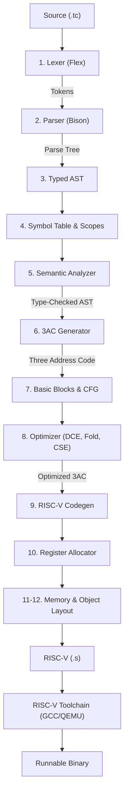

# TACCo Compiler Architecture

## Overview
TACCo (Totally Another C Compiler) is an end-to-end compiler for a C-style language implemented in C++17, compiling down to 64-bit RISC-V (RV64) assembly.

## Pipeline Flow

## Compiler Phases

1. **Lexical Analysis (Phase 1)**: Converts source text into strongly typed tokens, strips comments, and tracks source locations (`file:line:col`).
2. **Parsing (Phase 2)**: LALR(1) parsing using Bison, establishing operator precedence and producing an AST.
3. **AST Layer (Phase 3)**: Explicit object hierarchy for expressions, statements, types, and declarations using `std::unique_ptr`.
4. **Symbol Table (Phase 4)**: Lexical scopes, name resolution, and symbol definitions for variables, functions, and classes.
5. **Semantic Analysis (Phase 5)**: Type checking, lvalue validation, function signature checking, and member access verification.
6. **Three Address Code IR (Phase 6)**: Linear intermediate representation with virtual temporaries and explicit control flow.
7. **Basic Blocks & CFG (Phase 7)**: Leader detection, basic blocks, predecessors, successors, and DOT visualization.
8. **Optimization (Phase 8)**: Constant folding, constant propagation, algebraic simplifications, dead-code elimination, and common subexpression elimination.
9. **RISC-V Codegen (Phase 9)**: RV64 instruction emission, calling conventions, stack frame layout.
10. **Register Allocation (Phase 10)**: Linear-scan register allocation with spilling to stack slots.
11. **Arrays & Pointers (Phase 11)**: Base address calculations, pointer dereferencing, index scaling.
12. **Classes & Object Model (Phase 12)**: Contiguous object layout, field offsets, and member access lowering.
13. **Testing & Diagnostics (Phase 13)**: End-to-end test runner, error reporting, and release validation.
